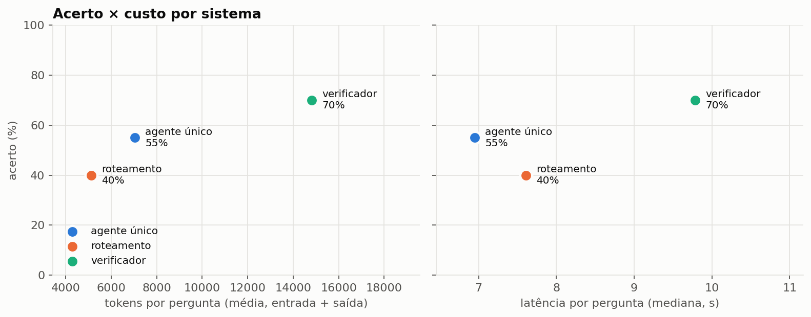

# text-to-sql-and-cypher

Perguntas em linguagem natural sobre os anúncios do Airbnb em São Paulo, respondidas por agentes de LLM que consultam um banco relacional (**PostgreSQL**, em SQL) e um banco de grafos (**Neo4j**, em Cypher) por meio de um **servidor MCP**. O projeto compara, com medições, um agente único e duas arquiteturas multiagente.

Trabalho 2 de DCA0305 (Projeto de sistemas baseados em aprendizado de máquina), UFRN.

**Vídeo de apresentação:** *(link a incluir)*

## Resultado em resumo

20 perguntas × 3 sistemas, todos com o mesmo modelo local (`qwen3:8b`, Q4_K_M, no Ollama, GPU T4 do Colab). O acerto é o da revisão humana, que concordou com o juiz em 98% das execuções.

| | agente único | roteamento | verificador |
|---|---|---|---|
| **acerto** | **55%** | **40%** | **70%** |
| acerto em SQL (10) / Cypher (6) / híbridas (3) | 70 / 33 / 33% | 60 / 17 / 0% | 80 / 50 / 67% |
| tokens por pergunta (média, entrada + saída) | 7.046 | 5.134 | 14.822 |
| latência mediana / p95 | 7,0 s / 32,5 s | 7,6 s / 47,6 s | 9,8 s / 71,5 s |
| trajetória esperada seguida | 75% | 75% | 85% |
| consultas escritas pelo modelo que rodaram sem erro | 88% | 93% | 83% |



- **O verificador acertou mais (+15 pontos) e custou o dobro de tokens.** Devolveu 6 respostas: 4 viraram certas, nenhuma resposta certa foi estragada. Não pegou os erros que o próprio modelo também comete (contador errado, relação com direção).
- **O roteamento acertou o banco nas 20 perguntas e mesmo assim teve o pior acerto.** Os especialistas, com menos contexto, escreveram consultas que rodam mas não respondem (o especialista do grafo desiste no primeiro resultado vazio e nunca usou a busca por nome).
- **O ponto fraco do modelo é o Cypher**, principalmente a direção da relação de vizinhança (`BORDERS`), e as perguntas capciosas sobre contadores.
- **Juiz × revisão humana: 98% de concordância (kappa 0,97).** A checagem automática por expressões regulares concordou em 97%.

A análise completa, com os erros por pergunta e a conclusão, está em [notebooks/04_analise.ipynb](notebooks/04_analise.ipynb); a tabela com todas as métricas, em [resultados/tabela_comparativa.csv](resultados/tabela_comparativa.csv).

## Dados

[Inside Airbnb](https://insideairbnb.com/get-the-data/), São Paulo, coleta de setembro de 2026: anúncios (`listings.csv.gz`, versão detalhada), avaliações (`reviews.csv.gz`) e os polígonos dos distritos (`neighbourhoods.geojson`). O recorte usa todos os anúncios da cidade e as avaliações de 2025 em diante, sem o texto. Os dados do Inside Airbnb são publicados sob a licença Creative Commons CC BY 4.0.

| Banco | Conteúdo |
|---|---|
| PostgreSQL | `neighbourhood` (96), `host` (15.883), `listing` (44.080), `listing_amenity` (1.251.474), `guest` (651.156), `review` (933.607) |
| Neo4j | nós `Host`, `Listing`, `Guest` e `Neighbourhood`; relações `HOSTS` (44.080), `LOCATED_IN` (44.080), `REVIEWED` (899.238) e `BORDERS` (235) |

Preços, notas, comodidades e datas ficam só no PostgreSQL. A vizinhança entre bairros (`BORDERS`, calculada dos polígonos) fica só no Neo4j. Os dois bancos compartilham as chaves `listing_id`, `host_id`, `guest_id` e o nome do bairro.

O repositório não contém os dados: contém o script que gera o recorte a partir dos arquivos baixados.

## Por que cada escolha

**O problema.** Responder perguntas sobre dados estruturados exige escrever consultas certas, e uma consulta pode rodar sem erro e devolver o número errado. Dados de hospedagem têm as duas formas de pergunta: as de atributo e número (preço, nota, comodidade, contagem), que o SQL responde bem, e as de relação (bairros vizinhos, hóspedes em comum entre anfitriões), que o grafo responde bem. Algumas precisam dos dois.

**Os dados.** O Inside Airbnb de São Paulo tem atributos numéricos de sobra (preço, 7 notas, capacidade, ocupação e receita estimadas), datas, comodidades e relações reais. Ele também tem armadilhas que testam o modelo: valores em inglês ('Pool', 'Entire home/apt') para perguntas em português, bairros sem acento ('Republica') e contadores que não batem com o recorte (`number_of_reviews` conta a vida toda do anúncio; `listings_count`, o Airbnb inteiro).

**A divisão entre os bancos.** Os números ficam só no SQL e a vizinhança só no grafo. Assim cada pergunta tem um banco certo (ou os dois), e o roteamento tem uma resposta certa e mensurável. O grafo não tem preços: "o preço médio dos vizinhos de Pinheiros" é híbrida de verdade.

**PostgreSQL e Neo4j.** O PostgreSQL dá um usuário somente leitura e um teto de tempo por consulta garantidos pelo próprio banco. O Neo4j foi escolhido no lugar do Memgraph porque modelos pequenos escrevem Cypher no dialeto do Neo4j.

**O servidor MCP.** Todo acesso aos bancos passa por ele, e as mesmas ferramentas servem aos 3 sistemas e ao juiz. As ferramentas devolvem o total de linhas e se o resultado foi cortado (o teto é de 50 linhas), porque um modelo que recebe uma lista cortada sem aviso conta errado. Os erros vêm com uma dica do que corrigir, para o modelo se recuperar dentro do loop. Há uma ferramenta de cálculo (`comparar_anuncios`) para a comparação não depender de conta feita pelo modelo.

**O modelo.** `qwen3:8b`, o modelo local da disciplina, com suporte a chamada de ferramentas, cabe na T4. Roda com temperatura 0, semente fixa, sem o modo de raciocínio (que deixava cada chamada muito mais lenta) e com contexto de 16.384 tokens: com 8.192, os dois esquemas mais os resultados estouravam o contexto em poucas voltas, e o Ollama cortava o prompt de sistema sem avisar.

**O framework.** LangGraph nos 3 sistemas, com o adaptador MCP do LangChain. A sessão MCP fica aberta durante toda a execução, para a latência medir o agente e não a partida do servidor.

**As arquiteturas.** As duas multiagente são construídas sobre o agente único, para cada uma mudar uma coisa só e o efeito dela poder ser medido:
- **Roteamento** ataca a falha vista no primeiro teste: o agente único ignorava o grafo nas perguntas híbridas. Hipótese: um roteador decide o banco antes de consultar, e especialistas com um esquema só (menos contexto) escrevem consultas melhores.
- **Verificador** ataca o tipo de erro mais comum no primeiro teste: nenhum erro de sintaxe, todos de sentido (a consulta rodava e devolvia o número errado). Hipótese: um segundo olhar, que confere se as consultas respondem à pergunta e se a resposta bate com os resultados, pega o que o loop de correção de erros não pega. Ele não olha sintaxe (o loop já corrige) nem contesta resultado vazio (na pergunta sobre item inexistente, vazio é a resposta certa).
- Ficaram de fora a paralelização (as perguntas são curtas e sequenciais: uma etapa depende do resultado da outra) e o supervisor com especialistas, que é um roteamento com mais voltas e mais custo.

**O juiz.** Claude (Sonnet), um modelo de fronteira, chamado pelo Claude Code em modo não interativo com a assinatura do grupo. O Claude Code é um cliente MCP, então o juiz usa as mesmas ferramentas dos agentes, só para leitura, e confere no banco o que a resposta afirma além do gabarito. A primeira escolha era o Gemini pela API, mas a camada gratuita só dava 20 pedidos por dia nos modelos Flash.

**As métricas.** As obrigatórias (acerto pelo juiz, trajetória, latência média, mediana e p95, tokens somados entre os agentes, chamadas ao modelo e às ferramentas, CPU, RAM e GPU) e as do tema: acerto contra um gabarito calculado nos bancos, taxa de consultas válidas, acerto de roteamento e devoluções do verificador que mudaram o veredito.

## Servidor MCP

`servidor/server.py` (FastMCP 4.1.4, transporte stdio):

| Tipo | Nome | O que faz |
|---|---|---|
| tool | `consultar_sql` | SELECT somente leitura no PostgreSQL |
| tool | `consultar_grafo` | Cypher somente leitura no Neo4j; avisa rótulo, relação ou propriedade inexistente e `BORDERS` com seta |
| tool | `buscar_entidade` | acha anúncio, anfitrião, hóspede, bairro ou comodidade pelo nome (sem diferenciar acentos); sinaliza homônimos e inexistentes; para anfitriões, mostra os anúncios em São Paulo e no Airbnb inteiro |
| tool | `detalhes_anuncio` | todos os dados de um anúncio |
| tool | `comparar_anuncios` | compara de 2 a 5 anúncios e calcula o vencedor de cada critério (ferramenta de cálculo) |
| resource | `esquema://sql`, `esquema://grafo` | esquemas e cuidados de cada banco |
| prompt | `analisar_bairro` | pede a análise de um bairro e a comparação com os vizinhos |

Chamadas incorretas devolvem erro de execução (`isError`) com uma dica do que corrigir; reenviar sem mudança a consulta que acabou de falhar é recusado, com o pedido de reescrevê-la. A escrita é bloqueada na ferramenta e no próprio banco. A validação sem LLM (`servidor/validar.py`, 57 de 57 casos) está em [resultados/validacao_servidor.md](resultados/validacao_servidor.md).

## Os três sistemas

Os três usam o mesmo modelo, as mesmas ferramentas do servidor MCP e a mesma interface `answer(pergunta)` (`agentes/comum.py`), que devolve a resposta com os dados da execução: ferramentas chamadas, chamadas ao modelo, tokens, tempo, CPU, RAM e GPU.

| Sistema | Arquivo | Como funciona |
|---|---|---|
| Agente único | `agentes/agente_unico.py` | um modelo com os dois esquemas e as 5 ferramentas, no loop modelo ⇄ ferramentas; o erro de uma consulta volta como mensagem e o modelo corrige |
| Roteamento | `agentes/roteamento.py` | um roteador (saída estruturada) escolhe `sql`, `cypher`, `ambos` ou `fora_do_escopo`; cada especialista é o agente único com um esquema só; em `ambos`, o grafo levanta as relações e o SQL calcula e responde; fora do escopo é uma recusa fixa |
| Verificador | `agentes/verificador.py` | o agente único responde; o verificador recebe a pergunta, as consultas com os resultados e a resposta, e aprova ou devolve com uma objeção e a evidência; no máximo 2 devoluções |

## Como executar

Os notebooks rodam no **Google Colab**, sem Docker. Só os que usam o modelo precisam de GPU T4.

**1. Gerar o recorte (uma vez, na sua máquina).** Em insideairbnb.com/get-the-data, na seção de São Paulo, baixe `listings.csv.gz`, `reviews.csv.gz` e `neighbourhoods.geojson` para uma mesma pasta e rode:

```bash
pip install -r dados/requirements.txt
python dados/recorte.py "<pasta com os 3 arquivos>" dados/recorte
```

Leva cerca de 30 segundos e grava 8 arquivos CSV (148 MB). Suba-os para uma pasta do seu Google Drive.

**2. Preparar o ambiente e validar o servidor.** Abra [notebooks/01_preparacao_e_servidor.ipynb](notebooks/01_preparacao_e_servidor.ipynb) no Colab (*Arquivo → Abrir notebook → GitHub*), mantenha o runtime padrão (só CPU), ajuste `DRIVE_DIR` na primeira célula e rode tudo.

**3. Os agentes.** Abra [notebooks/02_agentes.ipynb](notebooks/02_agentes.ipynb) com o runtime **T4 GPU**, ajuste `DRIVE_DIR` e rode tudo. A primeira célula prepara a sessão sozinha (`ambiente/preparar.py`, de 5 a 10 minutos) e as seguintes mostram os três sistemas respondendo as mesmas perguntas, com o trace de cada consulta e a checagem contra o gabarito.

**4. As 60 execuções.** Abra [notebooks/03_avaliacao.ipynb](notebooks/03_avaliacao.ipynb) com o runtime **T4 GPU**, ajuste `DRIVE_DIR` e `RESULTADOS_DIR` e rode tudo. O notebook faz as 60 execuções (20 perguntas × 3 sistemas), gravando no Drive a cada linha; se a sessão cair, rodar de novo continua de onde parou.

**5. O juiz.** Roda fora do Colab, numa máquina com os bancos carregados e o [Claude Code](https://docs.claude.com/en/docs/claude-code) instalado e logado numa conta Claude. Baixe `execucoes.csv` e `execucoes.jsonl` do Drive para `resultados/`, aponte `AIRBNB_PG_DSN` e `AIRBNB_NEO4J_URI` para os bancos e rode:

```bash
python avaliacao/juiz.py resultados --python-servidor <python com as libs de servidor/requirements.txt>
```

O juiz só usa a biblioteca padrão do Python; quem precisa das bibliotecas do servidor é o servidor MCP, que o Claude Code sobe com o `--python-servidor`. Se a cota da conta acabar, ele para; rodar de novo continua de onde parou.

**6. A análise.** Com os arquivos em `resultados/` (os desta rodada já estão no repositório), abra [notebooks/04_analise.ipynb](notebooks/04_analise.ipynb) (runtime padrão, só CPU, ou localmente) e rode tudo. Ele monta a tabela comparativa, os gráficos (gravados em `resultados/graficos/`), os erros por pergunta, o roteamento, o verificador e a concordância entre juiz, revisão humana e checagem automática. A revisão humana é feita no `resultados/revisao_manual.csv`, que o próprio notebook cria: preencha a coluna `veredito_humano` e rode de novo.

## Avaliação

`avaliacao/perguntas.py` tem as 20 perguntas, cada uma com categoria, banco, ferramenta esperada e a consulta de referência que calcula o gabarito direto nos bancos:

| Categoria | Perguntas |
|---|---|
| busca com filtro | P01, P02 (SQL); P09, P10 (Cypher) |
| item específico | P03, P04 (SQL); P11 (Cypher) |
| comparação | P05, P06 (SQL); P12 (Cypher); P15 (híbrida) |
| cálculo | P07, P08 (SQL); P13, P14 (Cypher); P16, P17 (híbridas) |
| capciosa | P18: "Quantos anúncios a Seazone tem?" (3.435 no Airbnb inteiro, 209 em São Paulo) |
| item inexistente | P19: a nota de um anúncio que não existe |
| fora do escopo | P20: a previsão do tempo |

Para ver as perguntas com o gabarito:

```bash
python avaliacao/gabarito.py
```

`avaliacao/avaliador.py` roda as perguntas nos sistemas pelo `answer()` e grava `execucoes.csv` (uma linha por execução, com as métricas e a checagem automática) e `execucoes.jsonl` (o registro completo de cada execução). `avaliacao/juiz.py` julga cada resposta com o Claude (modelo de fronteira), chamado pelo Claude Code em modo não interativo. Ele recebe a pergunta, o gabarito e a resposta, e tem acesso somente leitura ao servidor MCP: só as 5 ferramentas dele, com as ferramentas do próprio Claude Code (terminal, arquivos, web) desligadas. Grava `juiz.csv` e `juiz.jsonl` com o veredito (correta, parcial ou incorreta), a justificativa e as consultas que fez. As 60 respostas também foram revisadas pelo grupo (`resultados/revisao_manual.csv`).

**Ambiente da rodada:** Colab com Tesla T4 (15 GB), 2 CPUs, 12,7 GB de RAM; Python 3.13.16; Ollama 0.40.18; `qwen3:8b` (8,2 B parâmetros, Q4_K_M); langgraph 1.2.20, langchain-core 1.7.4, langchain-ollama 1.1.0, langchain-mcp-adapters 0.3.2, mcp 1.30.0. Registrado em [resultados/ambiente.json](resultados/ambiente.json).

## Estrutura

| Pasta | Conteúdo |
|---|---|
| `dados/` | recorte do dataset, esquema SQL e carga nos dois bancos |
| `servidor/` | servidor MCP e sua validação |
| `agentes/` | código comum (sessão MCP, modelo, medição, `answer()`) e um arquivo por sistema |
| `avaliacao/` | as 20 perguntas, o gabarito, a checagem automática, o avaliador, o juiz e a análise |
| `ambiente/` | instalação dos bancos, do servidor e do Ollama no Colab, e a preparação de uma sessão |
| `notebooks/` | notebooks para rodar no Colab |
| `resultados/` | validação do servidor, execuções, juiz, revisão manual, tabela comparativa e gráficos |
